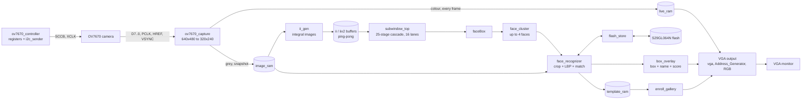

# Viola-Jones Face Detection and Recognition on an FPGA

Real-time face detection **and** face recognition in pure Verilog on a Terasic **DE2-115** (Intel Cyclone IV E
EP4CE115F29C7) with an **OV7670** camera. The system shows live video on a VGA monitor, draws a green box around every
face, and labels each face with the name of the enrolled person it matches and a match score (or `UNKNOWN`).
Enrolled people are stored in the on-board flash and survive power-off; the design boots from the configuration flash,
so no PC is needed in operation.

<!-- Add a photo of the result here, e.g. put it in images/ and uncomment:

-->

## Features

- **Camera interface**: OV7670 configured over SCCB (56 register writes), 640×480 RGB565 at 30 fps, reduced to 320×240.
- **Smooth live video**: every frame goes to a dedicated colour frame buffer read by the VGA logic (640×480 @ 60 Hz).
- **Viola-Jones detection**: integral image, Haar features, trained 25-stage cascade with 2,913 weak classifiers,
  **16 windows evaluated in parallel**, 8 scales (faces ~24 to ~190 pixels wide).
- **Clustering**: raw detections are merged into at most 4 faces; minimum group size selectable with switches.
- **LBP recognition**: 32×32 face crop, radius-1 and radius-2 uniform LBP, 4×4 cells × 20 bins (320-bin histogram),
  L1 distance to 4 views per person, 27-position search, fixed calibrated threshold (score ≥ 75 → name).
- **Enrollment** with one key press (4 views per person, 4 people) and **persistent storage** in the S29GL064N
  parallel NOR flash (header written last, so an interrupted save is never loaded).
- **Stand-alone boot** from the EPCS64 configuration flash.
- **On-board diagnostics**: LEDs for PLL lock, camera configuration, detection passes, flash activity, state machine
  states and a per-wire camera data monitor.

## Architecture



| Clock | Frequency | Used by |
|---|---|---|
| `clk_sys` | 40 MHz | main FSM, cascade, faceBox, face_cluster |
| `clk_iigen` | 100 MHz | ii_gen, face_recognizer, flash_store |
| `clk_50_camera` | 50 MHz | camera configuration (XCLK = 25 MHz) |
| `clk_25_vga` | 25 MHz | VGA timing, overlays, gallery |
| `ov7670_pclk` | ~25 MHz | pixel capture (from the camera) |

## Repository structure

```
.
├── designfile_testing/        Quartus project (open vj.qpf, revision "top")
│   ├── *.v                    37 hand-written Verilog files + Quartus MegaWizard cores
│   ├── *.txt, *.mif           trained cascade parameters (ROM contents) and the built-in test image
│   ├── top.qsf, top.out.sdc   device, pin assignments, timing constraints
│   └── output_files/          top.sof (JTAG) and top.jic (EPCS64 boot image)
├── simulation/                ModelSim testbenches + HOW_TO_RUN.txt
└── docs/                      USER_MANUAL.md / .pdf
```

## Hardware

| Item | Notes |
|---|---|
| Terasic DE2-115 | Cyclone IV E EP4CE115F29C7; SW19 on **RUN** to boot from EPCS |
| OV7670 camera module | on the 40-pin GPIO header JP5 (see table below) |
| VGA monitor + cable | 640×480 @ 60 Hz |
| USB-Blaster cable | only for programming |

Camera wiring (FPGA pins from `top.qsf`):

| Camera | D0 | D1 | D2 | D3 | D4 | D5 | D6 | D7 | PCLK | XCLK | PWDN | RESET | SIOC | SIOD | VSYNC | HREF |
|---|---|---|---|---|---|---|---|---|---|---|---|---|---|---|---|---|
| FPGA pin | AB22 | AC15 | AB21 | Y17 | AC21 | Y16 | AD21 | AD15 | AC19 | AF16 | AD19 | AF15 | AF24 | AE21 | AF25 | AC22 |
| Header pin | 1 | 2 | 3 | 4 | 5 | 6 | 7 | **9** | 13 | 14 | 15 | 16 | 17 | 18 | 19 | 20 |

3.3 V on header pin 29, GND on pin 30. D7 uses header pin 9 (GPIO[8]).

## Build and program

Requires Quartus Prime 20.1 (Lite is enough). From the `designfile_testing` folder:

```bash
quartus_sh --flow compile vj -c top
quartus_cpf -c -d EPCS64 -s EP4CE115 output_files/top.sof output_files/top.jic
quartus_pgm -m JTAG -o "pvi;output_files/top.jic"
```

The last command writes the boot flash; the board starts the design at every power-on (SW19 on RUN).
To load the design once without writing the flash: `quartus_pgm -m JTAG -o "p;output_files/top.sof"`.
Ready-made `top.sof` and `top.jic` are included in `output_files/`.

## Usage

| Control | Function |
|---|---|
| SW17 | reset (keep down) |
| SW15 | down = continuous detection, up = single capture with KEY0 |
| SW14 | built-in test image |
| SW13 | show boxes and labels |
| SW11–SW10 | enrollment slot 0–3 |
| SW2–SW0 | minimum face-group size (3 recommended) |
| KEY1 | enroll the person in front of the camera (turn the head slightly while LEDR4 is on) |
| KEY3 | forget everyone (erases the flash sector) |

Names are set in `designfile_testing/person_names.v` (12 characters each). The full description of all switches,
LEDs and the enrollment procedure is in [docs/USER_MANUAL.md](docs/USER_MANUAL.md).

## Simulation

Self-checking ModelSim testbenches (commands in [simulation/HOW_TO_RUN.txt](simulation/HOW_TO_RUN.txt)):

| Testbench | Checks | Result |
|---|---|---|
| `tb_sccb.v` | all 56 SCCB writes decoded, device id 0x42, COM7/COM15/MVFP values, XCLK 25 MHz | PASS |
| `tb_capture.v` | one 640×480 frame: 76,800 pixels, address order, every colour and grey value | PASS |
| `tb_flash.v` | flash model: power-on load, save (sector erase + programming), reload, erase | PASS |
| `tb_recog.v` | 4-view enrollment, recognition of shifted/resized faces, background rejected | PASS |

## Results

| Resource | Used | Utilisation |
|---|---|---|
| Logic elements | 45,878 / 114,480 | 40 % |
| Memory bits | 2,916,145 / 3,981,312 | 73 % |
| 9-bit multipliers | 371 / 532 | 70 % |
| Pins | 121 / 529 | 23 % |

- All clocks meet timing (worst setup slack +0.959 ns at 100 MHz).
- Live video at 30 fps; one detection + recognition pass takes about 1–2 s.
- Recognizer accuracy (bit-exact software model on the AT&T face database, 4 enrolled people):
  about 95 % correct names for enrolled people, about 85 % overall including rejection of strangers.

## Credits

The Viola-Jones cascade hardware is based on the senior design project *"E50: Parallelization of the Viola-Jones Face
Detection Algorithm on an FPGA"* (P. Irgens, C. Bader, T. Le, D. Saxena; advisor C. Ababei, 2016), originally in VHDL.
This repository converts it to Verilog and adds the colour/capture fixes, smooth live video, face clustering,
LBP face recognition, enrollment, flash storage, overlays and diagnostics.

## Team

<!-- Replace with your names and registration numbers -->
- Annet Maria Cyriac (26MVD0026)
- Anita Paul Puthur (26MVD0032)
- D Shameer (26MVD0029)

Vellore Institute of Technology, School of Electronics Engineering, 2026-27.
